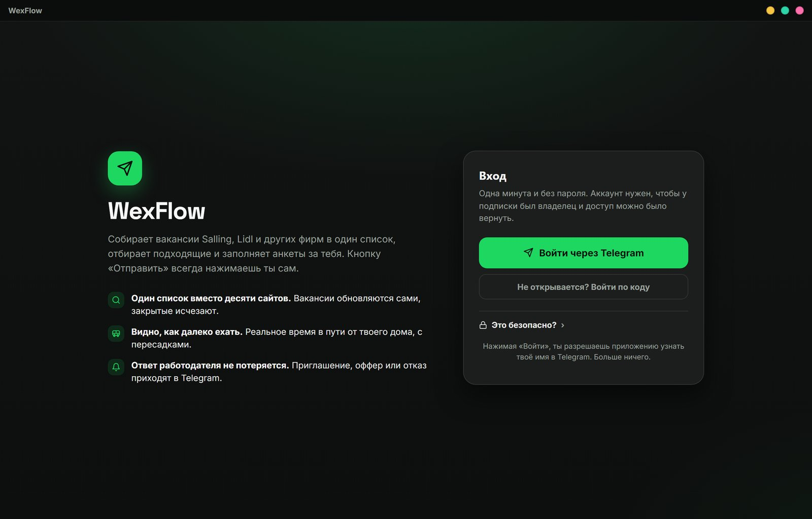

# WexFlow

Собирает вакансии Salling, Lidl и других фирм в Дании в один список, отбирает подходящие и заполняет анкеты за тебя. Кнопку «Отправить» всегда нажимаешь ты сам.

*A Windows app that gathers entry-level jobs in Denmark into one list and fills in applications for you. The interface is in Russian.*

**[⬇ Скачать WexFlow-Setup.exe](https://github.com/wexwxee/wexflow/releases/latest/download/WexFlow-Setup.exe)** · Windows 10 и 11 · [все версии](https://github.com/wexwxee/wexflow/releases)

## Что умеет

- **Один список вместо десяти сайтов.** Вакансии Salling Group, Lidl и компаний, которые нанимают через Teamtailor, Greenhouse и Ashby, обновляются сами, закрытые исчезают.
- **Видно, как далеко ехать.** Реальное время в пути от твоего дома, с пересадками.
- **Заполняет анкеты.** Берёт данные из твоего профиля, прикладывает резюме и останавливается перед отправкой.
- **Ответ работодателя не потеряется.** Приглашение, оффер или отказ приходят в Telegram.
- **Обновляется само.** Когда выходит новая версия, в приложении появляется кнопка обновления.

## Как начать

1. Скачай и запусти **WexFlow-Setup.exe**. Он сам поставит всё, что нужно для работы.
2. Если Windows покажет «Система Windows защитила ваш компьютер», нажми **Подробнее** → **Выполнить в любом случае**. Так бывает, потому что у приложения пока нет цифровой подписи.
3. Войди через Telegram. Это займёт минуту, пароль не нужен.
4. Заполни профиль и добавь резюме.

## Это безопасно?

- Пароль не спрашиваем и не храним. Вход подтверждает сам Telegram.
- Из Telegram приходят только имя и номер аккаунта. Переписка, телефон и контакты недоступны.
- Файл резюме никуда не загружается: он лежит на твоём компьютере, и приложение прикрепляет его прямо к анкете.
- Анкетные данные (имя, почта, телефон, адрес) хранятся в облаке и привязаны к твоему Telegram, чтобы не заполнять их заново на другом компьютере. Стереть их можно кнопкой «Удалить данные из облака».
- Заявки сами никуда не уходят: WexFlow заполняет анкету и останавливается, отправляешь ты.

## Если что-то не работает

- **Приложение не открывается или показывает старый экран.** Закрой все процессы WexFlow в диспетчере задач и открой приложение снова.
- **Не определяется местоположение.** Включи его в Параметрах Windows: Конфиденциальность и защита → Расположение. Или введи адрес вручную.
- **Анкета не заполнилась.** Сайты работодателей иногда меняют свои формы. Проверь, что профиль заполнен и резюме на месте, и попробуй ещё раз.
- **Нужна помощь** — пиши в Telegram: [@wexwxeee](https://t.me/wexwxeee).

---

WexFlow — независимый помощник. Он не связан с Salling Group, Lidl и их платформами найма. Исходный код закрыт, здесь публикуются готовые версии.
